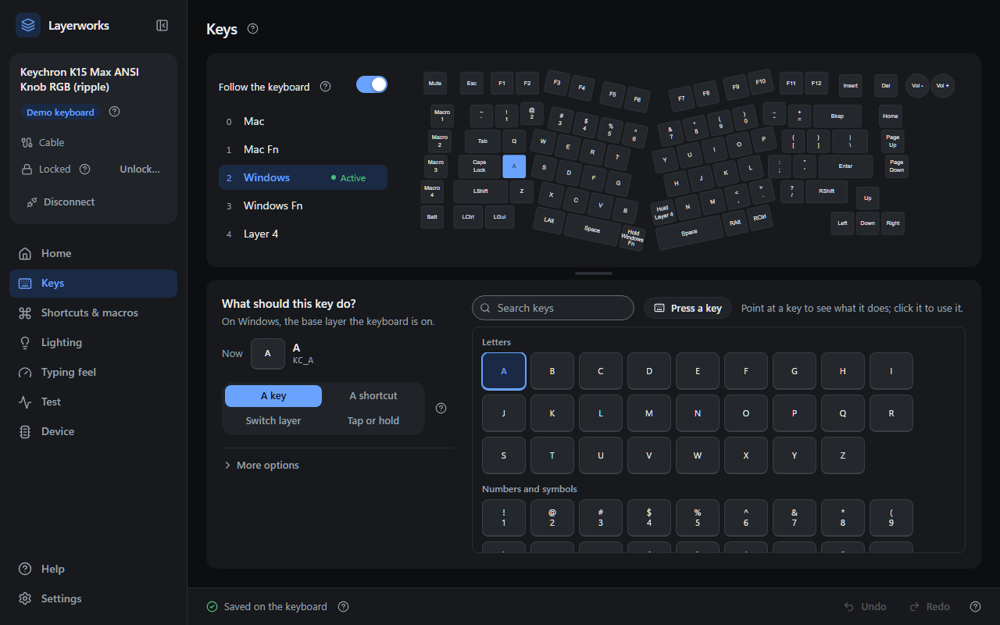
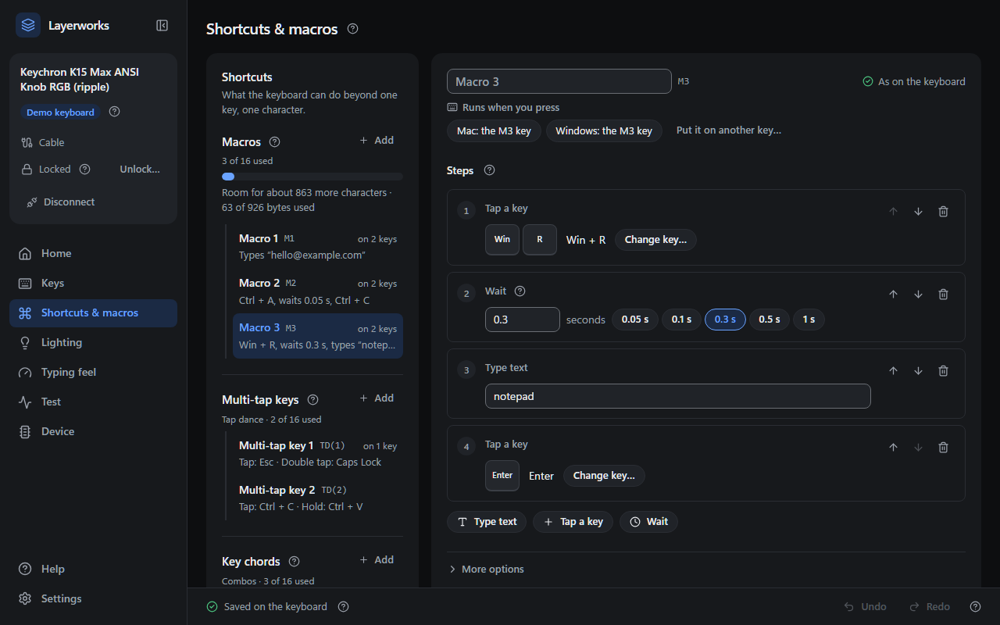
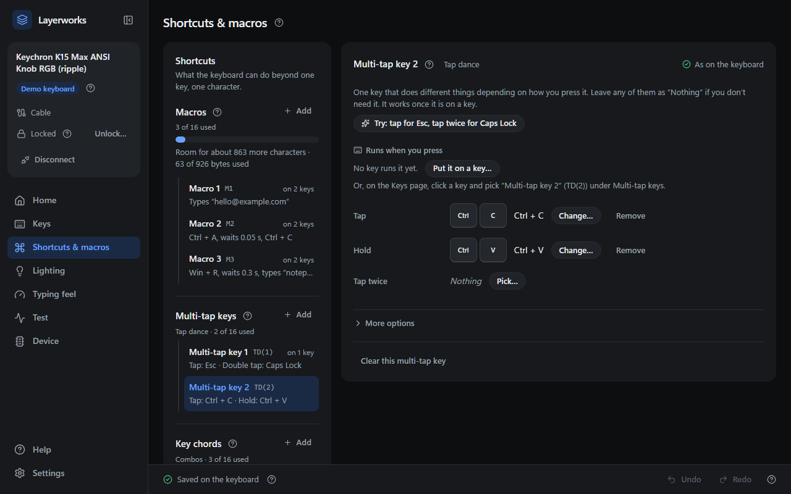
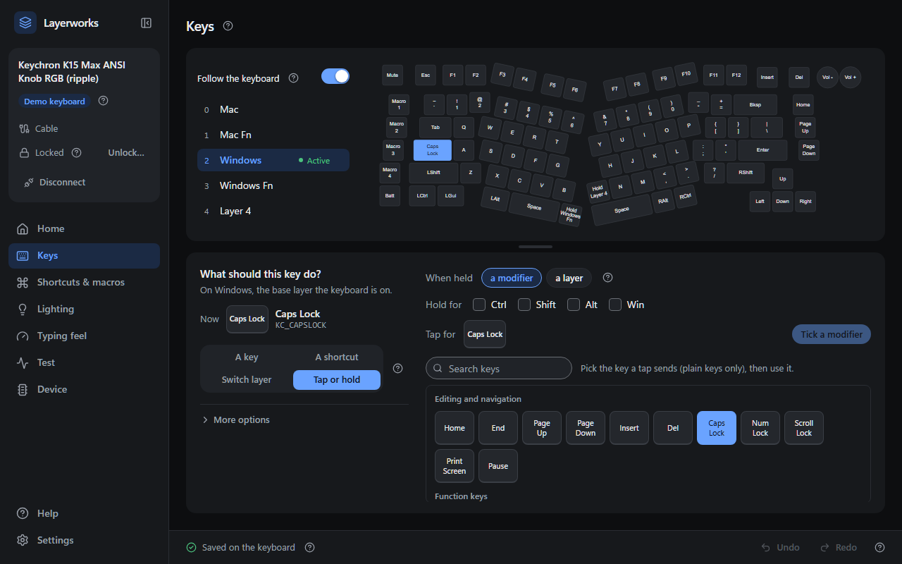
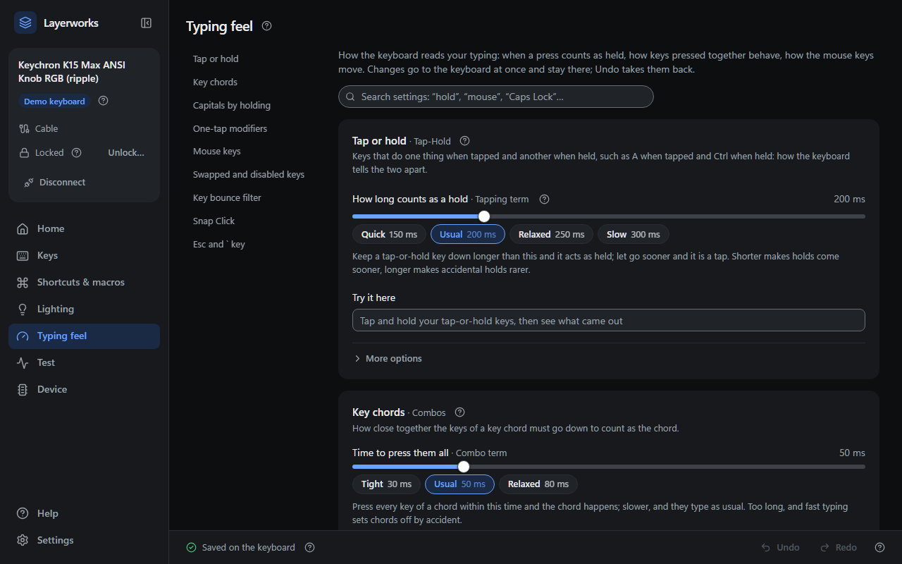
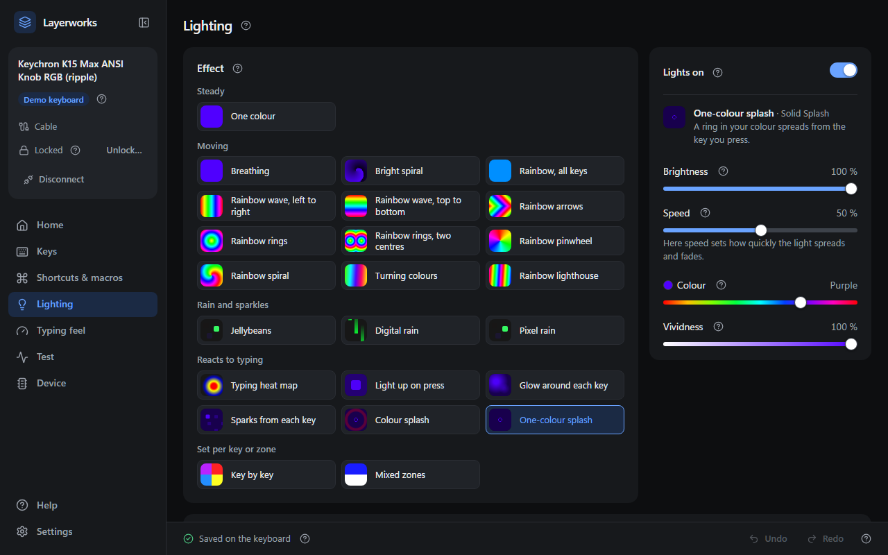
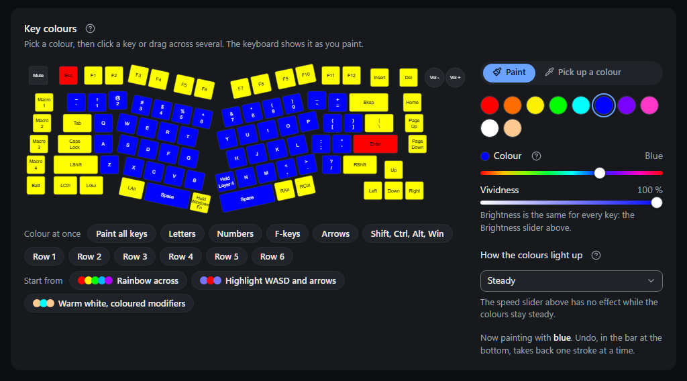
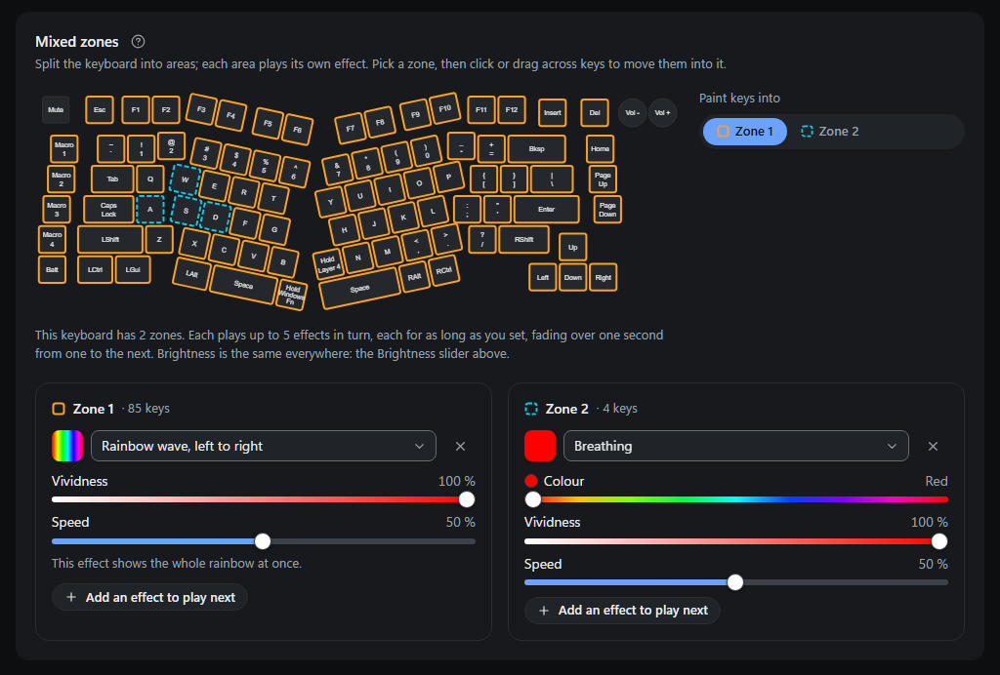
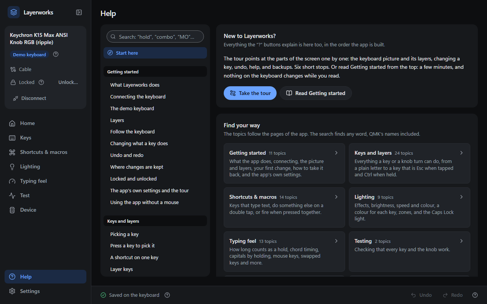

# Layerworks

Set up a keyboard that runs Vial firmware from your browser: keys, layers, macros, lighting and how typing feels,
explained in plain words. You don't need to know what a tap dance is to use one.

**[Open Layerworks](https://layerworks.tybyfy.com/)** in Chrome or Edge on a computer. No keyboard at hand? Pick
"Try the demo keyboard" and look around.



## Why I made this

I bought a Keychron K15 Max and wanted Shift + Backspace to send Delete. Keychron's Launcher can't do that, and
neither can VIA. Vial firmware can, along with multi-tap keys, key chords and a couple of dozen typing settings,
so I put Vial on the keyboard.

Then I met the apps. Vial firmware can do the most, but its apps are built for people who already speak QMK: walls
of key codes, settings spread over tabs and pop-ups, and next to nothing explained. Launcher is the one that is
pleasant to use, yet it adds little beyond a nicer screen, and it doesn't work with Vial firmware at all.

I like having every feature. I also like an interface that is easy, tidy and well explained. I couldn't find both
in one app, so this is my attempt:

- **Someone who has never heard of a macro can use it.** Plain names come first ("Multi-tap key"), with the QMK
  name beside them ("Tap dance") so the rest of the internet still makes sense. Every setting says what it does,
  with an example, and there is a guide and a search built in.
- **A few clear sections in a menu on the left**, each about one thing, instead of everything on one screen.
- **Everyday options are in view; the advanced ones are one click away** under "More options". Nothing is
  missing, it just isn't all shouting at once.
- **The picture is your keyboard.** It shows the layer the keyboard is on right now, and keys light up as you
  press them.

## What you can do with it

- **Keys.** Click a key or a knob in the picture and choose what it does: another key, a shortcut such as
  Ctrl + C, switching layer, or one thing when tapped and another when held. Or use "Press a key" and just press
  the key you want.
- **Shortcuts & macros.** Macros that type text or press a series of keys, recorded or built step by step. Keys
  that do something else on a double tap. Two keys pressed together that act as a third. Shortcuts that send
  something else, such as Shift + Backspace → Delete.
- **Lighting.** Every effect the keyboard has, with a preview, brightness, speed and colour. Keychron keyboards
  also get a colour per key, zones with their own effects, and the Caps Lock light.
- **Typing feel.** How long a press must last to count as a hold, how close together a key chord must be, mouse
  keys and more, with presets and a box to try them in. On Keychron keyboards also the key bounce filter and
  Snap Click.
- **Test.** Press every key to see that it arrives.
- **Device.** One backup file with everything in it. A restore first lists, in words, what it would change. Vial's
  `.vil` files can be read and written too. Sleep timers on wireless keyboards, and a reset to defaults.

Changes go to the keyboard straight away and stay there (a macro or shortcut when you save it). Undo and Redo
take them back, and Ctrl + Z works too. The whole app can be used without a mouse, in a dark or a light theme.

## A closer look

| | |
|---|---|
| **A macro, step by step:** tap a key, wait, type text.<br> | **A multi-tap key:** one thing on a tap, another on a hold or a double tap.<br> |
| **Tap or hold:** Caps Lock when tapped, a modifier when held.<br> | **Typing feel:** every setting says what it changes, with presets.<br> |
| **Lighting:** each effect with a preview.<br> | **Key by key:** pick a colour and paint the keys.<br> |
| **Mixed zones:** parts of the keyboard play their own effects.<br> | **Help:** a guide to everything, with a search that knows QMK's names too.<br> |

## Which keyboards

Layerworks works with keyboards running **Vial** firmware. It reads the keyboard's own description, so any Vial
keyboard should connect, and Keychron keyboards on Vial also get their extras (key colours and zones, key bounce
filter, Snap Click, wireless timers, battery).

It has been used on one real keyboard, a Keychron K15 Max, on the cable and through its 2.4 GHz receiver.
Everything else has only run on a built-in stand-in that answers as the firmware does: about twenty published
Vial keyboards of different shapes (split, ortholinear, number pads, macropads, full size, several knobs, other
Keychron models). If yours misbehaves, please [open an issue](https://github.com/phazei/layerworks/issues).

What it can't do:

- **Firmware without Vial.** Keyboards on VIA firmware, which includes the firmware Keychron ships, can't be used,
  and the app says so when you connect one. For Keychron's wireless keyboards, a Vial build comes from
  [tymon3310/vial-qmk](https://github.com/tymon3310/vial-qmk). Layerworks doesn't install firmware.
- **Bluetooth.** Use the cable or the keyboard's 2.4 GHz receiver.
- **Phones, Firefox and Safari.** Talking to a keyboard from a web page needs Chrome or Edge on a computer. The
  demo keyboard also works in other browsers.
- **Some lighting.** Effects can be changed on keyboards with VialRGB or Keychron's own lighting. Keyboards with
  plain backlight or underglow get their lighting keys, but no Lighting page.
- **More than one keyboard at a time.**

## Good to know

- **One app at a time.** Only one program can talk to the keyboard, so close Vial, Pipette or other configurator
  tabs first.
- **Back up first.** The Device page saves everything to one file, and puts it back.
- **Unlocking.** Vial firmware keeps a few things behind a lock, such as saving macros. The app tells you when it
  is needed and which keys to hold.
- **Nothing leaves your computer.** There is no account and no server: the page talks straight to the keyboard.
  Your names for layers and macros are kept in the browser and travel in the backup file.

## Something wrong?

Please [open an issue](https://github.com/phazei/layerworks/issues) and say which keyboard and firmware you have.
The Device page shows both under "About this keyboard".

## Working on the code

```
pnpm install
pnpm dev          # http://localhost:5199
```

- [`docs/README.md`](docs/README.md): how the app works inside, as a map of every document and section
- [`docs/spec.md`](docs/spec.md): the design, and why it is the way it is
- [`AGENTS.md`](AGENTS.md): the rules for working on the code, for people and for coding agents
- [`VENDOR.md`](VENDOR.md): the code copied from Pipette

## Thanks

Layerworks stands on other people's work:

- [Pipette](https://github.com/darakuneko/pipette-desktop) by darakuneko, and
  [tymon3310's fork](https://github.com/tymon3310/pipette-desktop) that adds Keychron support. Its key tables,
  layout reading, keyboard protocol code and keyboard picture are used here unchanged.
- [Vial](https://get.vial.today/), [VIA](https://www.caniusevia.com/) and [QMK](https://qmk.fm/), which make
  keyboards changeable in the first place.
- [tymon3310/vial-qmk](https://github.com/tymon3310/vial-qmk), the firmware that brings Vial to Keychron's
  wireless keyboards.

## Licence

GPL-3.0-or-later, see [`LICENSE`](LICENSE). Copyright © 2026 phazei.

If Layerworks saved you an evening, you can [say thanks on Ko-fi](https://ko-fi.com/phazei).
